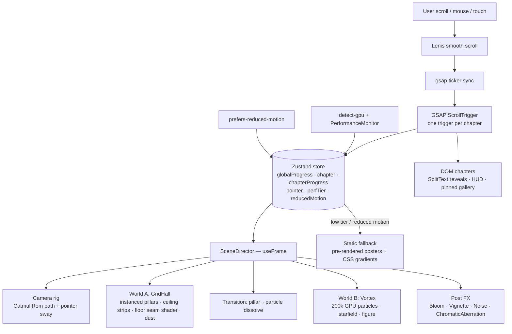
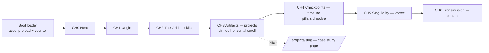

# PORTFOLIO_SPEC.md — "Signal to Singularity"
### Animated, story-driven personal portfolio for Atanu (techatanu)

> **For Claude Code:** this file is the single source of truth. Read it fully before doing anything.
> Follow the phases in order, stop at every **🛑 CHECKPOINT**, and never invent facts about Atanu —
> pull them from `/content/linkedin.pdf`, his GitHub, or ask him.

---

## 0. Hard rules (read first)

1. **Never run `git commit`, `git push`, `gh pr create`, or anything that writes to GitHub.** Atanu makes every commit and push himself so his contribution graph is 100% his. Prepare changes, then at the end of each phase print a suggested commit message and the exact commands for *him* to run. `git status` / `git diff` are fine.
2. **No fabricated content.** Name, education, dates, projects, skills, achievements come from `/content/linkedin.pdf`, the GitHub API for user `techatanu`, or Atanu directly. If something is missing, put `TODO(atanu): …` in `content/data.ts` and list it at the checkpoint.
3. **Reference images are mood boards only.** `/references/ref-grid-hall.jpg` and `/references/ref-vortex.jpg` are *not* shipped. The vortex image is artwork by Doğan Ural — recreate the *feeling* procedurally with an original composition; never trace it, embed it, or use it as a texture.
4. **Static-export only.** The site deploys to GitHub Pages at `atanu.online`. No server code, no API routes, no SSR-only features.
5. **Performance and accessibility are features, not polish.** Every WebGL effect must have a mobile tier and a `prefers-reduced-motion` fallback.
6. Ask before installing anything not listed in §3, and before opening external tools (Figma, Stitch, etc.).

---

## 1. Who this is for

| Field | Value |
|---|---|
| Owner | Atanu — 3rd-year student (confirm full name + degree from LinkedIn PDF) |
| Goal of the site | Land a **remote AI/ML internship** (also open to full-stack roles) |
| Audience | Recruiters, startup founders, ML engineers screening interns — they give it ~30–90 seconds |
| Location to display | **Rishihood University, Sonipat, Haryana** (not Kolkata) |
| Public email | `atanuadhikari5@gmail.com` |
| GitHub | `github.com/techatanu` |
| Domain | `atanu.online` (registered on Hostinger) → hosted on GitHub Pages |
| Current ML level | Python, NumPy, Pandas, scikit-learn; growing into deeper ML |
| Flagship project | **Infant-State-Recognition-System** — infant cry classifier (repo: `techatanu/Infant-State-Recognition-System`) |

**The recruiter test:** within 10 seconds of landing, a visitor must know *who he is, what he does, and that he's looking for an AI/ML internship* — even if the WebGL hasn't loaded. Story and spectacle come second to that.

---

## 2. Creative direction

### 2.1 The story: "Signal to Singularity"
The site is one continuous scroll-driven journey. The camera travels through two worlds that mirror Atanu's arc as an ML engineer: **structured data → learned patterns → infinite possibility.**

| # | Chapter | World / background | What the visitor sees | Content |
|---|---|---|---|---|
| — | **Boot** (loader) | Black, single horizontal light line | Terminal-style counter `INITIALIZING SIGNAL… 0–100%`, line expands into the grid floor | Name only |
| 0 | **Hero — "Hello, signal."** | Grid Hall, camera static at entrance, lights flicker on row by row | Big kinetic name, one-line role, his portrait as a **particle-assembled monochrome image** that resolves into the real photo | Name · "AI/ML Engineer in the making · Full-stack builder" · "Open to remote AI/ML internships" badge · scroll cue |
| 1 | **Origin — "Where the signal started"** | Camera begins dollying down the hall | Short paragraphs revealed line by line (SplitText), location tag | Education at Rishihood University, what drew him to AI, 3rd year — *from LinkedIn* |
| 2 | **The Grid — "Tools I think in"** | Deep in the hall; pillars light up as skills pass | Skills appear as glowing labels on/beside pillars, grouped: *ML & Data* · *Languages* · *Web / Full-stack* · *Tools* | From LinkedIn + GitHub languages |
| 3 | **Artifacts — "Things I've built"** | Hall opens into a wider chamber; floor seams pulse | Pinned horizontal-scroll gallery of project "exhibits". Flagship gets a full case-study panel | Infant cry classifier first (problem → data → model → result → what's next), then other repos |
| 4 | **Timeline — "Checkpoints"** | Pillars begin to **dissolve into particles** (transition) | Vertical timeline with nodes that ignite on scroll | Experience, certifications, hackathons, roles — *from LinkedIn* |
| 5 | **Singularity — "What's next"** | Cosmic Vortex: particle galaxy funnel; a tiny lone figure stands on the rim | Camera drifts toward the bright core; manifesto text | What he wants to learn/build; "Looking for a remote AI/ML internship" — the emotional peak |
| 6 | **Transmission — Contact** | Vortex settles into a slow orbit | Large CTA, copy-email button, links, resume download | Email, GitHub, LinkedIn, `resume.pdf` |

Narrative voice: first person, short sentences, quietly confident, no buzzword soup. Each chapter has a tiny mono "HUD" label (`CH.02 / THE GRID / 37.4%`) that tracks scroll progress — this is the thread that makes it feel like one story.

### 2.2 The two moving backgrounds (procedural, original)

**World A — "The Grid Hall"** (mood ref: `ref-grid-hall.jpg`)
- Infinite symmetric corridor of tall concrete pillars (instanced boxes, ~2 rows × 20, recycled as the camera moves → endless).
- Coffered ceiling with thin cold-white emissive light strips; floor is cracked dark concrete with **glowing seam lines** (shader: grid lines + noise-based cracks + sparse "circuit" glyph speckles).
- Exponential fog to near-black, cool blue-white tint, Bloom + subtle chromatic aberration + film grain + vignette.
- Motion: camera dolly is **scroll-driven** (not autoplay); idle state has slow light flicker, drifting dust motes, and floor seams that pulse forward like data packets. Mouse = gentle parallax/camera sway (±2°).
- Monochrome palette; the only colour is the light itself.

**World B — "The Cosmic Vortex"** (mood ref: `ref-vortex.jpg` — Doğan Ural artwork, inspiration only)
- GPU particle system: **~200k points desktop / ~40k mobile** distributed on a funnel (hyperboloid / log-spiral surface) curving into a bright off-centre core.
- Points are mostly white/silver with sparse **blue (#5B8CFF) and amber (#FFB36B)** sparkles; size attenuation; additive blending; brightness rises toward the core.
- Slow rotation of the swirl (vertex shader, time uniform) + curl-noise shimmer; scroll pulls the camera along a curve toward the core.
- A small silhouette **figure with a staff** (simple low-poly mesh or SVG sprite, original) standing on the rim, casting a long shadow line — represents Atanu at the edge of what's next. Use an original pose/composition.
- Starfield backdrop: separate static point layer.

**Transition A → B (Chapter 4):** pillars sample their surfaces into particles (pre-computed points per pillar), which drift and get pulled into the vortex — "structure becomes possibility". Crossfade fog/colour over the same scroll range.

**Portrait treatment (Hero):** his photo (`/public/images/atanu.jpg`) → background removed → monochrome. Rendered as a particle image (each particle samples a pixel's luminance) that assembles from scattered points on load, then crossfades to the real `` so the face is crisp. A slight cyan rim-light on hover.

### 2.3 Visual system (design tokens)

```
--bg:          #050506   (void)
--bg-elev:     #0C0D10
--fg:          #E8EAF0   (silver white)
--fg-muted:    #8A8F9C
--line:        rgba(232,234,240,0.12)
--glow:        #CFE3FF   (light-strip white-blue)
--accent-blue: #5B8CFF
--accent-amber:#FFB36B   (used sparingly — CTAs, "open to work" dot)

Display font:  "Clash Display" (Fontshare, free)  — huge, tight tracking
Body font:     "Satoshi" or "General Sans" (Fontshare, free)
Mono / HUD:    "JetBrains Mono" (Google Fonts)
Type scale:    clamp-based fluid; hero name ~ clamp(3.5rem, 12vw, 11rem)
Radius:        2px (sharp, architectural)   Motion easing: expo.out / power3.inOut
```
Self-host fonts (no runtime Google calls). Dark only.

### 2.4 Micro-interactions
- Custom cursor: small ring that grows on links, shows `VIEW` over projects (disabled on touch).
- Magnetic buttons on CTAs.
- Text reveals: GSAP SplitText by lines/chars, masked.
- Section HUD progress label + thin progress line on the right edge.
- Copy-email button with "copied ✓" morph.
- Optional ambient sound toggle (off by default, tiny "SOUND OFF" in corner). Ask Atanu before adding.

---

## 3. Tech stack (and why)

| Layer | Choice | Why |
|---|---|---|
| Framework | **Next.js 16 (App Router) + TypeScript**, `output: 'export'` | Static HTML for GitHub Pages, great DX, SEO metadata, file-based structure he can show recruiters. Confirm current stable with `npm view next version`. |
| Styling | **Tailwind CSS v4** + CSS variables for tokens | Fast, consistent, tokens drive both DOM and shader colours |
| 3D | **three.js + @react-three/fiber + @react-three/drei + @react-three/postprocessing** | Industry standard for WebGL in React; drei gives PerformanceMonitor, AdaptiveDpr, etc. |
| Shaders | GLSL via `three` `ShaderMaterial` (keep WebGL2 for compatibility; TSL/WebGPU optional later) | Full control for particles/floor seams |
| Scroll & animation | **GSAP 3 (ScrollTrigger, SplitText)** — all plugins are free now — via `@gsap/react` `useGSAP` | Best-in-class scroll choreography |
| Smooth scroll | **Lenis** synced to `gsap.ticker` | Silky scroll; ScrollTrigger reads Lenis position |
| State | **Zustand** (scroll progress, active chapter, perf tier) | Shared between DOM and Canvas without re-renders |
| GPU tiering | `detect-gpu` + drei `PerformanceMonitor` | Pick particle counts / effects per device |
| Icons | `lucide-react` | Light, consistent |
| Contact | `mailto:` + copy button (optionally Web3Forms/Formspree static form — ask) | No backend needed |
| Analytics | Optional: GoatCounter or Umami Cloud (privacy-friendly, works on static) — ask | |
| QA | Playwright (screenshots at 375/768/1440, reduced-motion run), Lighthouse CI | Visual regression + perf budget |
| Lint/format | ESLint (flat config) + Prettier | |
| Deploy | **GitHub Actions → GitHub Pages**, custom domain `atanu.online` via `public/CNAME` | Free, matches his chosen hosting |

> Alternative (only if Atanu asks): Vercel hosting removes static-export limits, but GitHub Pages is the decision.

---

## 4. Architecture

### 4.1 Pattern: "One canvas, many scenes"
A single fixed, full-viewport `<Canvas>` sits behind all DOM content. Normal HTML sections scroll on top. Scroll progress (0→1 per chapter and global) flows into a Zustand store; a `SceneDirector` inside the Canvas reads it every frame and drives camera path, world visibility, uniforms and post-processing. DOM never re-renders on scroll.



### 4.2 Page flow



### 4.3 Folder structure

```
/
├─ CLAUDE.md                     # generated in Phase 0 — rules + commands summary
├─ PORTFOLIO_SPEC.md             # this file
├─ content/
│  ├─ linkedin.pdf               # INPUT — Atanu drops this here
│  └─ data.ts                    # typed content extracted from PDF + GitHub (single source)
├─ references/                   # INPUT — mood boards only, never imported by code
│  ├─ ref-grid-hall.jpg
│  └─ ref-vortex.jpg
├─ public/
│  ├─ images/atanu.jpg           # INPUT — his photo (original)
│  ├─ images/atanu-cutout.webp   # generated: background removed, monochrome
│  ├─ images/posters/*.avif      # generated: static fallbacks of each world
│  ├─ projects/*.webp            # project screenshots
│  ├─ resume.pdf                 # INPUT (ask Atanu)
│  ├─ og.png                     # 1200×630 social preview
│  ├─ CNAME                      # "atanu.online"
│  └─ .nojekyll
├─ src/
│  ├─ app/
│  │  ├─ layout.tsx              # fonts, metadata, <SmoothScroll>, <Experience>
│  │  ├─ page.tsx                # composes chapters
│  │  ├─ projects/[slug]/page.tsx  # generateStaticParams for case studies
│  │  ├─ sitemap.ts · robots.ts
│  │  └─ globals.css             # tokens, Tailwind
│  ├─ components/
│  │  ├─ canvas/
│  │  │  ├─ Experience.tsx       # fixed <Canvas>, dpr clamp, Suspense
│  │  │  ├─ SceneDirector.tsx    # reads store → camera, visibility, uniforms
│  │  │  ├─ CameraRig.tsx
│  │  │  ├─ GridHall/ (Pillars.tsx, Ceiling.tsx, Floor.tsx, Dust.tsx, shaders/)
│  │  │  ├─ Vortex/   (Galaxy.tsx, Starfield.tsx, Figure.tsx, shaders/)
│  │  │  ├─ Transition/PillarDissolve.tsx
│  │  │  ├─ PortraitParticles.tsx
│  │  │  └─ Effects.tsx          # postprocessing stack per tier
│  │  ├─ chapters/ (Boot, Hero, Origin, Skills, Artifacts, Timeline, Singularity, Contact).tsx
│  │  ├─ ui/ (Hud, ProgressRail, Cursor, MagneticButton, SplitReveal, CopyEmail, Nav).tsx
│  │  └─ providers/ (SmoothScroll.tsx, PerfProvider.tsx)
│  ├─ lib/ (store.ts, scroll.ts, perf.ts, chapters.ts — scroll ranges config, github.ts)
│  └─ shaders/ (*.glsl)
├─ scripts/
│  ├─ fetch-github.mjs           # build-time: pull public repos → content/github.json
│  └─ make-posters.mjs           # Playwright: screenshot each world → posters
├─ tests/visual.spec.ts          # Playwright screenshots + reduced-motion run
├─ .github/workflows/deploy.yml  # build → upload-pages-artifact → deploy-pages
└─ next.config.ts                # output:'export', images.unoptimized, trailingSlash
```

### 4.4 Content model (`content/data.ts`)

```ts
export const profile = { name, role, tagline, location: "Rishihood University, Sonipat, Haryana",
  email: "atanuadhikari5@gmail.com", github: "https://github.com/techatanu", linkedin, resumeUrl: "/resume.pdf",
  openTo: "Remote AI/ML internships · Full-stack roles" };
export const origin: { paragraphs: string[] };
export const skills: { group: "ML & Data" | "Languages" | "Web / Full-stack" | "Tools"; items: string[] }[];
export const projects: { slug; title; oneLiner; problem; approach; stack: string[]; results; next; repo; live?; image; featured: boolean }[];
export const timeline: { date; title; org; detail; kind: "education"|"experience"|"certification"|"event" }[];
export const manifesto: string[];   // Chapter 5 copy — draft, Atanu approves
```

### 4.5 Performance budget & tiers

| Tier | Detected by | Particles (vortex) | Post FX | DPR | Dissolve |
|---|---|---|---|---|---|
| High | desktop GPU tier ≥2 | 200k | Bloom + CA + Noise + Vignette | ≤2 | full |
| Medium | tier 1 / laptop iGPU | 80k | Bloom + Vignette | ≤1.5 | simplified |
| Low / mobile | tier 0, mobile | 30–40k | Bloom (half-res) | ≤1.25 | crossfade only |
| Reduced motion / no WebGL | media query / context fail | — | — | — | static AVIF posters + CSS gradients, no smooth scroll |

Targets: LCP < 2.5s on 4G mobile (hero text is HTML, not canvas), CLS ≈ 0, JS < 350 KB gz initial (lazy-load the Canvas after first paint), 60fps desktop / 45+ mobile, Lighthouse Perf ≥ 85 mobile, A11y ≥ 95, SEO 100. Pause rendering when tab hidden (`frameloop` demand when idle).

### 4.6 Accessibility & SEO
- Semantic landmarks, one `h1`, real text for everything shown in WebGL, visible focus states, keyboard-navigable gallery, `aria-hidden` on canvas, alt text on portrait.
- Full content readable with JS disabled (static export renders it).
- Metadata: title "Atanu — AI/ML Engineer in the making", description, Open Graph + Twitter card with `og.png`, JSON-LD `Person` (name, url, sameAs: GitHub, LinkedIn; affiliation: Rishihood University), sitemap, robots, canonical `https://atanu.online`.

---

## 5. AI tool pipeline (design → code → deploy)

| Stage | Tool | Use it for | Who drives |
|---|---|---|---|
| Inspiration | **Awwwards** (Portfolio + Storytelling + WebGL filters), **Godly** (animated previews), **Codrops** (WebGL/particle tutorials), **Siteinspire**, **Lapa Ninja** | Collect 5–8 references for layout, type, motion | Atanu (Claude Code may suggest) |
| Study code | **Bruno Simon folio-2025** (open source, MIT) · **The Monolith Project** (scroll story with R3F + GSAP) · Codrops "Particles Galaxy" & "Procedural Vortex (TSL)" | Learn patterns, don't copy | Claude Code reads, adapts |
| Fast UI exploration | **Google Stitch** (Google Labs) | Generate 2–3 layout directions for Hero / Artifacts / Contact from a prompt; export **DESIGN.md** + "Paste to Figma". Treat output as a sketch, not final code. | Atanu in browser; Claude Code writes the Stitch prompt for him |
| Refine design | **Figma** + **Figma MCP server** in Claude Code | Clean up chosen direction, set tokens; Claude Code reads frames via MCP | Atanu designs; Claude Code reads |
| Photo prep | Canva / remove.bg / Photoshop | Remove background from portrait, export 1200px WebP | Atanu (or Claude Code with `rembg` locally — ask) |
| Build | **Claude Code** | Everything in this spec | Claude Code |
| Visual QA | **Playwright MCP** or Playwright tests | Screenshots across breakpoints, check reduced-motion | Claude Code |
| Perf QA | Lighthouse (Chrome DevTools) | Budgets in §4.5 | Claude Code runs, Atanu reviews |
| Deploy | **GitHub Actions → GitHub Pages**; DNS at **Hostinger** | Auto-deploy on push to `main` | Claude Code writes files; **Atanu commits & pushes** |

MCP setup commands Claude Code may suggest (Atanu runs them, then restarts Claude Code):
```bash
# Figma (official remote server; or install the official Figma plugin)
claude mcp add --transport http figma https://mcp.figma.com/mcp
# Playwright (browser automation for screenshots)
claude mcp add playwright -- npx @playwright/mcp@latest
```
(Stitch also offers an MCP/SDK route — check its current docs before suggesting it.)

---

## 6. Build phases & checkpoints

### Phase 0 — Intake (no code yet)
1. Verify inputs exist: `content/linkedin.pdf`, `public/images/atanu.jpg`, `references/*.jpg`. List any missing and ask.
2. Read the LinkedIn PDF; fetch public repos for `techatanu` (GitHub REST API, unauthenticated is fine).
3. Draft `content/data.ts` with every fact sourced; mark gaps `TODO(atanu)`.
4. Draft all chapter copy (§2.1) in Atanu's voice.
5. Create `CLAUDE.md` (rules from §0, commands, structure).
6. **🛑 CHECKPOINT 0:** show the extracted facts, draft copy, the TODO list, and ask: (a) full name/role line OK? (b) which projects to feature and in what order? (c) does he have a resume PDF? (d) sound toggle yes/no? (e) does he want to do a Stitch/Figma design pass first, or go straight to code with this spec's design system?

### Phase 1 — Design direction (optional, if he said yes)
1. Write a ready-to-paste **Stitch prompt** (dark cinematic portfolio, tokens from §2.3, chapters from §2.1) and ask Atanu to run it, pick a direction, and share the DESIGN.md / Figma link.
2. If Figma MCP is connected, read the frames and reconcile with §2.3.
3. **🛑 CHECKPOINT 1:** confirm final tokens, fonts, hero layout.

### Phase 2 — Scaffold
`create-next-app` (TS, App Router, Tailwind, ESLint, `src/`), install stack from §3, configure static export, fonts, tokens, Lenis + GSAP ticker sync, Zustand store, chapter scroll-range config, empty chapter sections with real HTML content, HUD + progress rail. Site must be fully readable at this point with no WebGL.
**🛑 CHECKPOINT 2:** `npm run dev` URL + screenshot; suggested commit message.

### Phase 3 — World A: Grid Hall
Instanced recycling pillars, ceiling strips, floor seam shader, dust, fog, post FX, scroll-driven camera dolly, pointer sway, perf tiers. Compare against `ref-grid-hall.jpg` for *mood* (tonality, light quality, depth), iterate with screenshots.
**🛑 CHECKPOINT 3:** screenshots desktop + mobile, fps numbers.

### Phase 4 — World B: Vortex + transition
GPU particle funnel, starfield, original figure on the rim, pillar→particle dissolve over Chapter 4 range, camera path into the core. Compare to `ref-vortex.jpg` for *mood* only.
**🛑 CHECKPOINT 4:** screenshots + short screen recording instructions for Atanu to review.

### Phase 5 — Story & interaction polish
Boot loader, portrait particle assembly, SplitText reveals, pinned project gallery, case-study pages, timeline ignition, cursor, magnetic buttons, copy-email, HUD labels.
**🛑 CHECKPOINT 5:** full scroll-through review.

### Phase 6 — Hardening
Reduced-motion + no-WebGL fallbacks (generate posters with Playwright), keyboard/a11y pass, SEO + JSON-LD + OG image, Lighthouse runs vs §4.5 budgets, Playwright visual tests at 375/768/1440, fix regressions.
**🛑 CHECKPOINT 6:** Lighthouse scores table + remaining issues.

### Phase 7 — Deploy setup (Atanu pushes)
1. `next.config.ts`: `output: 'export'`, `images: { unoptimized: true }`, `trailingSlash: true`.
2. `public/CNAME` → `atanu.online`; `public/.nojekyll`.
3. `.github/workflows/deploy.yml`: on push to `main` → setup Node 20+ → `npm ci` → `npm run build` → `actions/upload-pages-artifact` (path `out`) → `actions/deploy-pages`.
4. Give Atanu a checklist:
   - Create repo (e.g. `techatanu/portfolio` or `techatanu.github.io`) — with a custom domain no `basePath` is needed.
   - **He** runs `git add . && git commit -m "…" && git push`.
   - Repo → Settings → Pages → Source: **GitHub Actions**; Custom domain: `atanu.online`; tick **Enforce HTTPS** once the cert is issued.
   - Hostinger DNS: `A @ 185.199.108.153`, `A @ 185.199.109.153`, `A @ 185.199.110.153`, `A @ 185.199.111.153`; `CNAME www → techatanu.github.io`. Remove conflicting old A/CNAME records. (Verify against GitHub's current Pages docs.)
   - Wait for DNS propagation, then test `https://atanu.online` and `https://www.atanu.online`.
5. **🛑 CHECKPOINT 7:** post-deploy smoke test list (links, resume download, OG preview via a link debugger, mobile).

---

## 7. Definition of done
- [ ] Recruiter test passes: name, role, "open to remote AI/ML internships", and contact visible above the fold without WebGL.
- [ ] Both worlds animate smoothly and are driven by scroll; transition A→B reads as one story.
- [ ] All content sourced from LinkedIn/GitHub/Atanu — zero invented facts, zero `TODO(atanu)` left.
- [ ] Location shows Rishihood University, Sonipat, Haryana; email `atanuadhikari5@gmail.com`.
- [ ] Reduced-motion and mobile tiers work; Lighthouse budgets met.
- [ ] Reference images not shipped; vortex is an original composition.
- [ ] Deploy workflow, CNAME, DNS checklist delivered; **no commits or pushes made by Claude Code**.
- [ ] `README.md` explains how to update content (`content/data.ts`), add a project, and run locally.
