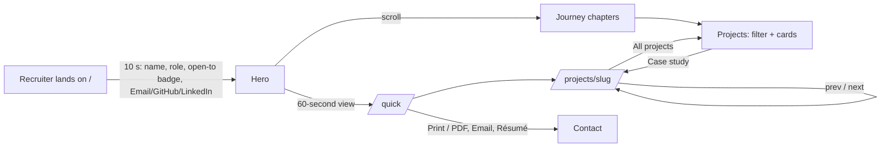

# Architecture v2 — recruiter-first, still cinematic

`PORTFOLIO_SPEC.md` stays the source of truth for rules, tokens and the 3D world. This file adds
the structure that makes the site fast to evaluate for recruiters. Decisions in `CLAUDE.md`
("Design decisions that override the spec") still win.

## 1. What the research says (Oct 2026)

| Finding | Source | What we do |
|---|---|---|
| Recruiters decide in ~30–60 s and want a fast overview; engineers want depth. Dual views work. | scottspence.com, fueler.io, hiration | Two paths: the cinematic journey **and** a plain `/quick/` page. |
| Portfolios are used to *verify* claims: repo, README, live demo, your role. | recrew.ai, scale.jobs, proxify | Every project shows role, repo, demo or an honest note, plus a case-study page. |
| ML case studies: problem → data/approach → results/metrics → next steps. Fewer, deeper projects beat many notebooks. | prepvector, interviewkickstart, springboard | `/projects/[slug]/` pages in that order; a featured top 3 on home and quick view. |
| Lead with measurable results. | fueler.io | Optional `headline` per project, taken from that project's own sourced results. |
| "Open to work" belongs in the nav on every page, not only on Contact. | framer "Ping" template | Availability chip in both headers. |
| Accessibility and speed are hiring signals; don't trade speed for animation. | brightcoding, hiration | Subpages ship no WebGL; print-friendly quick view. |
| Strong dev portfolios (Brittany Chiang, Awwwards DA winners such as Elliott Mangham and Bruno Simon): name and role first, numbered sections, project cards with tags and screenshots, a full archive link, résumé one click away. | brittanychiang.com, awwwards.com | Numbered cards, tag filters, covers, archive-style case studies, résumé in every header. |

## 2. Information architecture (all static export)

```
/                       Cinematic journey (existing chapters + 3D code singularity)
/quick/                 60-second recruiter view: one page, no WebGL, printable
/projects/<slug>/       Case study per project (10, via generateStaticParams)
/sitemap.xml /robots.txt  Generated by app/sitemap.ts and app/robots.ts
```



### Route groups

```
src/app/
├─ layout.tsx                 root: <html>, fonts, metadata, JSON-LD, skip link, Cursor
├─ (journey)/layout.tsx       Backdrop, SmoothScroll, PerfProvider, Experience (WebGL), Nav, ProgressRail,
│                             LevelBanner, GameReveal — only the home page pays for the 3D world
├─ (journey)/page.tsx         chapters (unchanged order, see src/lib/chapters.ts)
├─ (pages)/layout.tsx         Backdrop (CSS only) + SiteHeader; no canvas, no Lenis
├─ (pages)/quick/page.tsx
├─ (pages)/projects/[slug]/page.tsx
├─ sitemap.ts · robots.ts · opengraph-image (static)
```

## 3. Components

| Area | Component | Notes |
|---|---|---|
| Shared | `ui/SiteHeader` | Name → home, Projects, Quick view, Contact, Résumé; availability chip. |
| Projects | `project/ProjectCover` | Uses `public/projects/<slug>.webp` **only if the file exists at build time**; otherwise an original generative SVG cover seeded by slug (no fake screenshots). |
| Projects | `project/ProjectLinks`, `project/ProjectMeta` | Shared by home cards, quick view and case studies. |
| Projects | `chapters/Artifacts` + `project/ProjectFilter` | Featured case study + filterable grid (All · AI & ML · Full-stack · Data viz · Systems). Without JS, every card stays visible. |
| Case study | `project/CaseStudy` | Header (tags, title, one-liner, links) · sticky "At a glance" (role, stack, category) · Problem · Approach · Results (highlighted) · What's next · prev/next. |
| Quick view | `quick/*` | Identity block, top 3 projects with headline result, skills, timeline, contact; `@media print` stylesheet. |
| SEO | `seo/JsonLd` | `Person` (name, url, email, sameAs GitHub/LinkedIn, affiliation). Per-project `generateMetadata`. |
| Later | `ui/CommandPalette` (⌘K) | Jump to sections and case studies, copy email, download résumé. Chunk 2. |

## 4. Content model additions (`content/data.ts`)

- `Project.category`: `"ai-ml" | "full-stack" | "data" | "systems"`, a classification of existing tags, not a new fact.
- `Project.headline?`: a short result line copied from that project's own `results`. Empty when there's no metric.
- `projectFilters`, `caseStudy`, `quickView`, `seo`: UI copy only.
- Rule unchanged: facts come only from LinkedIn, résumé, GitHub or Atanu; gaps stay `TODO(atanu)` and are hidden in production by `src/lib/content.ts`.

## 5. Delivery plan (one chunk = one commit by Atanu)

| Chunk | Contents | Built by |
|---|---|---|
| 1 | Route groups, SiteHeader, data model (done by lead) · case studies + project covers + filters · quick view + nav/hero links · SEO (sitemap, robots, JSON-LD, OG, `.nojekyll`) | Lead + 3 Sonnet agents in parallel on disjoint files |
| 2 | ⌘K command palette · magnetic CTAs · project screenshots script (`scripts/shoot-projects.mjs`, Playwright, run by Atanu) | Sonnet agents |
| 3 | Phase 6 hardening: Lighthouse, a11y pass, reduced-motion review, tests for new routes | Sonnet agent + lead review |
| 4 | Phase 7 deploy: GitHub Actions → Pages, DNS checklist | Lead |

## 6. Agents (`.claude/agents/`)

| Agent | Model | Owns |
|---|---|---|
| `projects-builder` | Sonnet | `src/components/project/**`, `src/app/(pages)/projects/**`, `src/components/chapters/Artifacts.tsx` |
| `quick-view-builder` | Sonnet | `src/app/(pages)/quick/**`, `src/components/quick/**`, `Nav.tsx`, `Hero.tsx` links |
| `seo-builder` | Sonnet | `src/app/sitemap.ts`, `robots.ts`, `opengraph-image.*`, `src/components/seo/**`, root `layout.tsx` metadata, `public/.nojekyll` |
| `portfolio-reviewer` | Sonnet | Read-only: checks invented facts, a11y, budgets, CLAUDE.md rules |

Every agent: reads `CLAUDE.md` and this file first; edits only the files it owns; makes no git writes;
installs nothing; puts copy in `content/data.ts` (lead-owned; agents ask in their report); runs `npx tsc --noEmit`
and `npm run lint`. The lead runs `npm run build` once at the end to avoid parallel builds into `out/`.

## Sources
- https://scottspence.com/posts/job-hunt-dev-project
- https://fueler.io/blog/what-recruiters-actually-want-to-see-in-a-backend-developer-portfolio
- https://www.recrew.ai/glossary/portfolio-tech-hiring
- https://scale.jobs/blog/portfolio-content-for-tech-jobs-what-recruiters-want
- https://proxify.io/knowledge-base/job-descriptions/what-makes-a-developer-portfolio-stand-out-to-recruiters
- https://prepvector.substack.com/p/building-a-strong-portfolio-for-machine
- https://interviewkickstart.com/blogs/articles/machine-learning-engineer-portfolio
- https://www.framer.com/community/marketplace/templates/ping/
- https://www.hiration.com/blog/build-portfolio-for-job-search/
- https://brittanychiang.com
- https://www.awwwards.com/websites/winner_category_portfolio/
